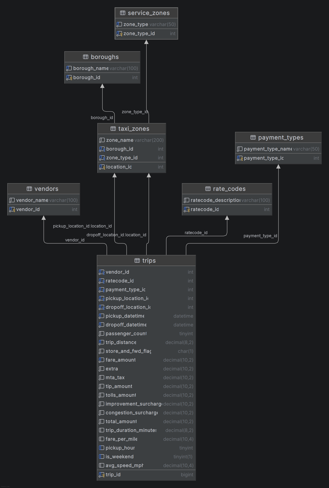

# Urban Mobility Analytics


An interactive web dashboard for exploring NYC Yellow Taxi trip data (January 2019). Built with Python Flask, PostgreSQL, and vanilla JavaScript with Chart.js.

## Links

| Item | Link |
| --- | --- |
| Video walkthrough (5 min) | https://www.loom.com/share/7acbad24181a4e89837bd5f26966a0c1       https://www.loom.com/share/c7bfde00351849f190454265f8cda249       |
| GitHub repository | https://github.com/nabdurahim-art/urban-mobility-analytics |
| Team participation sheet | 
https://docs.google.com/spreadsheets/d/15Sz4TBO8d6fXeJ1PU95Zj8LHh8p3loeepdafaxbFk9I/edit?gid=0#gid=0 |


## Team

**Team name:** Urban Mobility Team

| Member | Area |
| --- | --- |
| Nshimiyimana Abdurahim | Data cleaning and feature engineering |
| Batsinde Ange Liana | Database design and loading |
| Batsinda Keynes Benoit | Backend API and custom algorithms |
| Mucyo Joel | Frontend dashboard |

> Check that each member's area matches what they actually built, and add anyone missing (for example the GitHub owner, Abdull-Kudus).

## What It Does

- Cleans and processes 7.6 million raw taxi trip records
- Stores the data in a normalized PostgreSQL database
- Serves the data through a Flask REST API
- Displays an interactive dashboard with charts, filters, and a trip records table

## Tech Stack

| Layer | Technology |
| --- | --- |
| Data processing | Python (cleaning and feature engineering scripts) |
| Database | PostgreSQL 14+ |
| Backend | Python 3.10+, Flask REST API |
| Frontend | HTML, CSS, vanilla JavaScript, Chart.js 4.4 (CDN), Inter font (Google Fonts) |

## Database Schema (ERD)



## Project Structure

```
urban-mobility-analytics/
├── backend/                  # Flask API
│   ├── app/
│   │   ├── api/              # Route handlers (trips, analytics)
│   │   └── db/               # Database connection
│   ├── config.py             # Loads environment variables
│   ├── requirements.txt      # Python dependencies
│   └── run.py                # Starts the Flask server
├── data/                     # Data processing scripts
│   ├── clean_tripdata.py     # Cleans and validates raw trip data
│   ├── feature_engineering.py# Adds derived columns
│   ├── data_pipeline.py      # Runs cleaning + engineering in order
│   └── taxi_zone_lookup.csv  # Zone dimension table
├── database/                 # SQL schema files
├── docs/                     # ERD diagram and documentation
├── frontend/                 # Web dashboard
│   ├── index.html            # Main page
│   ├── styles.css            # Styling
│   └── dashboard.js          # Charts, table, and filters
├── load_trips.py             # Loads cleaned CSV into PostgreSQL
├── .env.example              # Template for environment variables
└── README.md
```

## Requirements

- Python 3.10 or higher
- PostgreSQL 14 or higher
- A modern web browser (Chrome, Firefox, Edge) with internet access, because the dashboard loads Chart.js and fonts from CDNs
- Several GB of free disk space for the Parquet input, cleaned CSV, and database
- 8 GB of RAM recommended for processing the 7.6 million trip records

## Setup Instructions

Run every command from the project root unless stated otherwise.

### 1. Clone the repository

```bash
git clone https://github.com/nabdurahim-art/urban-mobility-analytics.git
cd urban-mobility-analytics
```

### 2. Create a virtual environment

```bash
python -m venv .venv
```

Activate it:

- Windows: `.venv\Scripts\activate`
- Mac/Linux: `source .venv/bin/activate`

### 3. Install Python dependencies

```bash
pip install -r backend/requirements.txt
```

### 4. Set up environment variables

Copy the example file and fill in your PostgreSQL credentials:

```bash
cp .env.example .env
```

Edit `.env`:

```
DB_HOST=localhost
DB_PORT=5432
DB_NAME=urban_mobility
DB_USER=postgres
DB_PASSWORD=your_password_here
DB_SSLMODE=disable
```

Never commit your real `.env` file.

### 5. Create the database

Open PostgreSQL and run:

```sql
CREATE DATABASE urban_mobility;
```

Or use Python:

```bash
python -c "
import psycopg
conn = psycopg.connect(host='localhost', port=5432, dbname='postgres', user='postgres', password='your_password', autocommit=True)
conn.cursor().execute('CREATE DATABASE urban_mobility')
conn.close()
print('Done')
"
```

### 6. Download the raw data files

Place these files in the `data/` folder:

| File | Source |
| --- | --- |
| `yellow_tripdata_2019-01.parquet` | [NYC TLC Trip Record Data](https://www.nyc.gov/site/tlc/about/tlc-trip-record-data.page) |
| `taxi_zone_lookup.csv` | Included in this repo |
| `taxi_zones.geojson` | Included in this repo |

Download the January 2019 yellow taxi Parquet file into `data/`:

```bash
curl -L "https://d37ci6vzurychx.cloudfront.net/trip-data/yellow_tripdata_2019-01.parquet" \
  -o data/yellow_tripdata_2019-01.parquet
```

### 7. Run the data pipeline

This cleans the raw data and adds derived features (trip duration, fare per mile, pickup hour, weekend flag, average speed):

```bash
python data/data_pipeline.py
```

This takes about 8 minutes and produces `data/yellow_cleaned_tripdata.csv`.

### 8. Create the database tables

```bash
psql -U postgres -d urban_mobility -f database/schema.sql
```

If `psql` is not in your PATH, open `database/schema.sql` in pgAdmin and run it there.

### 9. Load the trip data into PostgreSQL

```bash
python load_trips.py
```

This loads all 7.6 million rows using PostgreSQL `COPY` and takes about 15 minutes.

## Running the Application

### Start the backend API

```bash
cd backend
python run.py
```

The API runs at http://localhost:5001 by default. Set `PORT` to use a different port.

### Open the frontend

Open http://localhost:5001 in your browser to use the dashboard served by Flask.

If your backend runs on a different port, change `API_BASE` at the top of `frontend/dashboard.js`.

### Verify it works

1. The "Backend Online" badge in the top-right of the dashboard turns green.
2. The four KPI cards and four charts fill in within a few seconds.
3. The trip table shows 50 rows per page.

You can also test the API directly:

```bash
curl http://localhost:5001/api/analytics/hourly-demand
```

## API Endpoints

| Method | Endpoint | Description |
| --- | --- | --- |
| GET | `/api/trips` | Paginated trip records with filters |
| GET | `/api/analytics/hourly-demand` | Trip count per hour of day |
| GET | `/api/analytics/revenue-by-zone` | Total revenue per pickup zone |
| GET | `/api/analytics/average-fare-per-mile` | Avg fare by distance bucket |
| GET | `/api/analytics/top-revenue-zones` | Top N zones by revenue (`?n=10`) |
| GET | `/api/zones` | All taxi zones |

### `/api/trips` query parameters

| Parameter | Description |
| --- | --- |
| `page`, `limit` | Pagination (the dashboard uses 50 rows per page) |
| `start_date`, `end_date` | Date range, format `YYYY-MM-DD HH:MM:SS` |
| `pickup_zone` | Pickup borough name (for example `Manhattan`) |
| `min_fare`, `max_fare` | Fare range in dollars |
| `min_distance` | Minimum trip distance in miles |

Example:

```
GET /api/trips?start_date=2019-01-01 00:00:00&end_date=2019-01-07 23:59:59&pickup_zone=Manhattan&min_fare=10&page=1&limit=50
```

## Features

- **Filters:** date range, pickup borough, fare range, minimum distance
- **KPI cards:** total trips, average fare, average distance, average speed
- **Charts:**
  - Trips per hour of day (bar chart)
  - Revenue by borough (horizontal bar chart)
  - Average fare by distance group (grouped bar chart)
  - Top 10 revenue zones using a custom merge sort (horizontal bar chart)
- **Trip table:** paginated, 50 rows per page, with borough colour badges
- **Live status:** clock and a backend online/offline indicator in the navbar
- **Responsive design:** layout adapts to tablet and phone screens
- **Error handling:** a toast message appears if the backend can't be reached or a filter is invalid

## Custom Algorithms

The project implements sorting by hand instead of relying only on built-in functions:

| Where | Algorithm | Purpose |
| --- | --- | --- |
| Backend | Merge sort | Ranks the top N revenue zones |
| Frontend (`dashboard.js`) | Insertion sort | Orders boroughs by revenue for the borough chart |

## Data Cleaning Summary

| Issue | Action Taken |
| --- | --- |
| Missing values | Rows with null pickup/dropoff times or location IDs dropped |
| Duplicate trips | Identified and removed based on all key columns |
| Fare outliers | Trips with fare < $2.50 or > $500 excluded |
| Distance outliers | Trips with distance = 0 or > 100 miles excluded |
| Time anomalies | Trips with duration < 1 min or > 3 hours excluded |
| Passenger count | Rows with 0 or > 6 passengers excluded |

All excluded records are logged in `data/exclusion_log.csv`.

## Derived Features

| Feature | Formula |
| --- | --- |
| `trip_duration_minutes` | (dropoff_time - pickup_time) in minutes |
| `fare_per_mile` | total_amount / trip_distance |
| `pickup_hour` | Hour extracted from pickup timestamp |
| `is_weekend` | 1 if Saturday or Sunday, else 0 |
| `avg_speed_mph` | trip_distance / (duration / 60) |

## Troubleshooting

| Problem | Fix |
| --- | --- |
| Dashboard shows "Backend Offline" | Make sure `python run.py` is running and `API_BASE` in `dashboard.js` matches the port |
| Charts are empty or you see "Could not load data" | Check the terminal running Flask for errors and confirm the database has data loaded |
| `psycopg` connection errors | Check the values in `.env` and that PostgreSQL is running |
| `psql` is not recognized | Add PostgreSQL's `bin` folder to your PATH, or run the SQL in pgAdmin |
| Page is unstyled or icons and fonts are missing | The dashboard needs internet access for Chart.js and Google Fonts |
| Browser blocks requests to the API (CORS error) | Make sure CORS is enabled in the Flask app (for example with `flask-cors`) |

## Known Limitations

- The dashboard covers January 2019 only. Filters default to that month.
- The KPI cards for average fare, distance, and speed are calculated from the current page of trips (50 rows), while "Total Trips" is the full count matching the filters.
- The dashboard needs internet access to load Chart.js and fonts from CDNs.
- Loading the full dataset takes about 25 minutes in total (cleaning plus loading).

## Future Improvements

- Calculate KPI averages over the full filtered dataset on the server
- Add a map view of pickup and drop-off zones using `taxi_zones.geojson`
- Support more months of data and a month selector
- Add automated tests for the API and the cleaning scripts

## Acknowledgements

- Data: [NYC Taxi and Limousine Commission (TLC) Trip Record Data](https://www.nyc.gov/site/tlc/about/tlc-trip-record-data.page)
- Charts: [Chart.js](https://www.chartjs.org/)
- Font: [Inter](https://fonts.google.com/specimen/Inter)
